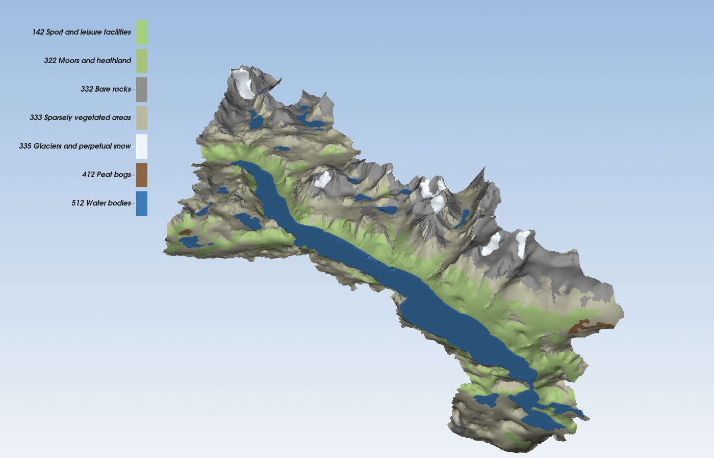

# Rasputin

Rasputin turns a digital elevation model (DEM) into a triangulated irregular
network (TIN): a triangle mesh of the terrain that uses few triangles where the
ground is smooth and many where it is rough, and never strays from the DEM by
more than a height tolerance you choose.



*The Bygdin catchment (305 km²) at a 10 m tolerance, each triangle coloured by
its CORINE land-cover class. Elevation © Kartverket (CC BY 4.0); land cover
© European Union, Copernicus Land Monitoring Service 2018, EEA. How it was made:
`docs/benchmarks/2026-09-29/bygdin-landcover.md`.*

## What it does

- **DEM in, mesh out.** One GeoTIFF, several, or a directory of tiles
  (Kartverket's DTM10, for example), stitched into one grid.
- **DEMs from the network.** `rasputin fetch glo30 --domain X` copies the
  Copernicus GLO-30 tiles a mesh of that domain reads into a tile cache, so
  `rasputin mesh --dem glo30` then runs offline; `anadem-v1` (South America)
  likewise.
- **Lakes and land cover from the network.**
  `rasputin fetch nve-lakes --bbox XMIN YMIN XMAX YMAX` copies the lake
  polygons of NVE's lake database (Innsjødatabasen) meeting the box, and
  `rasputin fetch clc2018 --bbox ...` the CORINE Land Cover 2018 polygons
  from the European Environment Agency's map service; no account is needed.
  The box is in the source's CRS (EPSG:25833 and EPSG:3035), or in
  `--out-crs`; `--domain FILE` takes a polygon's box instead. Each lands as
  one GeoPackage in the tile cache, and `rasputin sources` then lists it with
  its path and the options it fits (`mesh --features` with `--features-legend
  corine`, `catchment --lakes`). A rerun asks only for polygons not yet
  cached. The credits go into a `NOTICE.txt` beside the file: NVE's data is
  under the Norwegian licence for open government data (NLOD 1.0), which
  asks you to name NVE and the licence; CORINE is the EU Copernicus Land
  Monitoring Service's, free and open, asking you to name the source, say
  that it was modified (cut to a box) and not suggest EU endorsement.
- **A domain.** Mesh only the inside of a polygon, such as a catchment
  (GeoJSON or WKT, in any CRS that pyproj reads).
- **Features as constraints.** Lakes, land-cover borders, roads and rivers
  (GeoJSON, GeoPackage or GML) become edges of the mesh, so no triangle
  crosses them. A GML 3.2 file of surfaces, such as NIBIO's AR50 land-resource
  map, is converted once with `rasputin gml-to-gpkg SOURCE --out OUT.gpkg`;
  the shipped `ar50` legend reads its land type (`arealtype`) and splits
  forest by tree type (`treslag`, codes 3031 to 3099) and open firm ground by
  vegetation cover (`vegetasjonsdekke`, codes 5051 to 5099).
- **Land-cover labels, cleaned up.** With a CORINE legend, every triangle
  gets the class of the polygon it lies in. First the borders are repaired
  (`--features-repair`), merged between neighbours of one class, snapped onto
  the domain outline where they nearly touch it, and simplified to
  `--features-tolerance` metres with each class keeping its area.
- **Refinement to a tolerance.** Triangles are split at the worst DEM point
  until every triangle is within `--tolerance` metres of the DEM, then kept
  Delaunay, with a minimum-angle start so there are no slivers along the
  boundary.
- **Refinement to a triangle count.** `--triangles N` instead of
  `--tolerance` asks for about N triangles: rasputin searches for the
  tolerance that gives them, reports it, and writes the mesh `--tolerance`
  writes at that tolerance. `--max-triangles M` is the hard cap (default 5 %
  over N). The count written is between 2N − M and M when the search finds
  a tolerance that gives one, otherwise the largest it found under M; never
  over M. A cap under the fewest triangles the outline and feature lines
  make is refused, and the message names that fewest count. A budget run
  also reports the root-mean-square height error over the DEM nodes inside
  the mesh; a `--tolerance` run does with `--rms` (one more pass over the
  mesh).
- **A tolerance that varies.** `--tolerance-near FILE N` with
  `--tolerance-ramp START END` holds the mesh to N metres along named lines
  (a railway, a river) and ramps to the general tolerance with distance;
  `--tolerance-slope N START END` does the same on steep ground.
- **Catchments.** `rasputin catchment` computes the catchment of a lake
  (a `--seed` point in it) or of a gauge on a mapped river (`--rivers`) from
  the DEM, and writes a GeoJSON polygon ready for `--domain`.
  `rasputin fetch-stations nve-hrd` fetches NVE's reference gauging stations
  with their catchments and rivers; `rasputin station-catchments` runs them
  all and compares.

## Quick example

Install first ([INSTALL.md](INSTALL.md)); the example needs the `codecs`
extra, because the committed DEM tile is LZW-compressed. The install is
bounds-checked by default; INSTALL.md's "Bounds checks" section says how to
build an unchecked copy for heavy runs. Every run uses every core unless
`--threads N` or the environment variable `RASPUTIN_THREADS` says otherwise
(0 means every core). From the repository root:

```sh
# A 50 km DTM10 tile, meshed inside a quarter disc of radius 30 km,
# to within 1 m of the DEM.
rasputin mesh \
    --dem tests/fixtures/dem_archive/7908_3_10m_z33.tif \
    --domain docs/benchmarks/2026-09-26/quarter.geojson \
    --tolerance 1 \
    --out quarter.vtk

# The same, with CORINE land cover as constraints and labels,
# at a 5 m tolerance.
rasputin mesh \
    --dem tests/fixtures/dem_archive/7908_3_10m_z33.tif \
    --domain docs/benchmarks/2026-09-26/quarter.geojson \
    --features tests/fixtures/corine/clc2018_7908_3.gpkg --features-legend corine \
    --tolerance 5 \
    --out quarter_landcover.vtk

# The same quarter disc with about 100,000 triangles: the tolerance
# that gives them is found and reported.
rasputin mesh \
    --dem tests/fixtures/dem_archive/7908_3_10m_z33.tif \
    --domain docs/benchmarks/2026-09-26/quarter.geojson \
    --triangles 100000 \
    --out quarter_budget.vtk

# Natural colours for the land-cover classes, for ParaView.
rasputin palette corine --out corine.json
```

The first command writes about 430,000 triangles in under two seconds on a
laptop (Apple M1 Max). Add `--stats -` to print sizes, mesh quality and
timings, and `--record run.json` to write the run's record, for reproducing it.

`rasputin --help` lists the commands, and `rasputin mesh --help` explains
every option.

## Output and viewing

- **`.vtk`** (legacy VTK, one file) is for [ParaView](https://www.paraview.org).
  It holds the triangles, the constraint edges with their feature bits and,
  with a legend, the cell array `land_cover_code`. To colour by land cover,
  import `corine.json` in ParaView's Colour Map Editor (Choose Preset, Import)
  and colour by `land_cover_code`.
- **`.ply`** is for QGIS and other mesh tools. The surface goes to `--out`,
  and the constraint edges, if you want them, to a second file named by
  `--out-edges`.

Both formats are binary by default; `--ascii` writes text you can read with
`head`. Every mesh file records what it was made from, and stderr gets a
one-line summary of the run.

## Connect an agent

An AI agent (Claude Desktop, Codex, or any other client of the Model
Context Protocol, MCP) can drive rasputin through a small server built in.
Install the `mcp` extra (the `dev` extra includes it):

```sh
pip install "rasputin[mcp]"
```

`rasputin mcp` then serves the commands over stdin and stdout. Point the
client at the `rasputin` of the environment you installed into, or at
`python -m tin_engine mcp` with that environment's `python`. Claude Desktop
takes this in `claude_desktop_config.json` (on macOS under
`~/Library/Application Support/Claude/`):

```json
{"mcpServers": {"rasputin": {"command": "/path/to/venv/bin/rasputin", "args": ["mcp", "--out-root", "/path/to/outputs"]}}}
```

Codex takes the same two fields in `~/.codex/config.toml`:

```toml
[mcp_servers.rasputin]
command = "/path/to/venv/bin/rasputin"
args = ["mcp", "--out-root", "/path/to/outputs"]
```

Those two fields are all a client needs. Every file a tool call writes, except
the tile cache `fetch` fills when no `cache` is given, must lie inside the
output root, `--out-root`, else the call is refused: a path
that leads out through `..` or a symbolic link is refused too. Missing folders
inside the root are made as needed, the root among them. Without
`--out-root` the root is `~/rasputin-output`. The tools that take an input
file read it wherever it is. An `env` table is optional: with
`env = { RASPUTIN_DATA = "/path/to/data" }` the server reads the cache in
`/path/to/data/cache`, and a `/path/to/data/sources.toml`, if one exists, as
your sources file; without it, the cache is in `~/.cache/rasputin` (or
`$XDG_CACHE_HOME/rasputin`).

The agent sees one tool per rasputin command (`sources`, `mesh`, `catchment`,
`fetch`, `fetch_stations`, ...; the names use underscores), each with the command's
options as its input schema, help text included, so an option added to the
CLI is a new tool argument with no further work. A call returns the exit code,
stdout and stderr, each output file as a `file://` link and, for `mesh`, the
run record and the `--stats` report as data; the mesh itself never travels
through the agent. A refused command comes back as an error carrying the
CLI's own `Error:` words. During a long run the server reports every line the
command prints to stderr and a heartbeat every 5 s while it is silent; cancelling the
call kills the run. One call runs at a time unless `--jobs N` says more. One
caveat: a `mesh` cancelled while writing a `.vtk` or `.ply` can leave a
truncated file under the asked name, so rerun before reading it; a `.gpkg`
goes through a `.part` file and a rename, so it cannot.

`sources` is the one to call first, and the server tells the agent so: it lists
every elevation and land-cover source the machine knows, local and remote,
with its coverage as a longitude/latitude box, cell size in metres, CRS,
height unit, description and credit, read from the files' headers (with
`bbox`, the share of an area each covers). The agent passes the chosen
source's id as `dem` to `mesh`, `catchment` or `station_catchments`.
The listing also names vector datasets (polygons, lines, points) with their
path, layer, geometry types, feature count, attributes and, for land cover,
the class values, and it reports the output root as `out_root`. Each source's
`fits` names the tools and arguments it can be given to (`mesh` `features`
with the legend to pass, `catchment` `lakes`, `station_catchments`
`stations`, ...), read from the file's header; the agent passes a vector
source's path, not its id.

Data already on the machine is registered by name in your sources file,
`~/.config/rasputin/sources.toml` (or `$XDG_CONFIG_HOME/rasputin/sources.toml`;
a `$RASPUTIN_DATA/sources.toml`, if one exists, is read instead). One table per
dataset:

```toml
[source.my-terrain]
kind = "local"
path = "/data/terrain-10m"    # a directory of GeoTIFF tiles, or one GeoTIFF
credit = "© The data's owner"
licence_note = "CC BY 4.0"
description = "Bare-ground terrain model, 10 m cells."
```

A vector dataset is a `.gpkg`, `.geojson` or `.json` path; `layer` names the
table of a GeoPackage that holds more than one, and `legend` the legend
a land-cover file is coded in:

```toml
[source.my-lakes]
kind = "local"
path = "/data/hydrography/lakes.geojson"
credit = "© The data's owner"
licence_note = "CC BY 4.0"
description = "Lake polygons, 1:50 000."

[source.my-land-cover]
kind = "local"
path = "~/data/landcover.gpkg"
layer = "landcover"
legend = "corine"
credit = "© The data's owner"
licence_note = "CC BY 4.0"
description = "Land-cover polygons, minimum mapping unit 25 ha."
```

A relative `path` is taken from the file's directory, and `~` is your home.
The CRS, cell size and coverage come from the files themselves; `z_unit = "metre"` names the
height unit for files that do not state it. `rasputin sources` on the
command line shows the same listing, and says which sources file it read.
An installed plugin may add datasets of its own (`docs/plugins.md`, *Ship
datasets*).

### Serving over HTTP

`rasputin mcp --http` serves the same tools over HTTP, for agents on other
machines, from your own machine or one server. Results then come back as
download links instead of file paths: each output file is copied into the
user's store and named by its sha256, and the result carries a link to it,
valid 1 hour (the `download_link` tool makes a fresh one). Small text, such as
the run record and the `--stats` report, still comes back inline.

Each user has a bearer token, given to the server in `RASPUTIN_MCP_TOKENS` as
`user=token` pairs separated by spaces. A user name is a lowercase letter
followed by up to 31 of `a-z`, `0-9`, `_` and `-`; a token has at least 32
characters, and the server keeps only its hash. Make one with
`python -c "import secrets; print(secrets.token_urlsafe(32))"`:

```sh
export RASPUTIN_MCP_TOKENS="ola=<token> kari=<token>"
rasputin mcp --http --out-root /srv/rasputin --public-url https://rasputin.example.org
```

The server listens on `--host` and `--port`, by default `127.0.0.1:8765`.
Put TLS in front of it with a reverse proxy or a tunnel, and give the
address clients use as `--public-url`: links are built on it, and it must be
`https` unless it is loopback (a `--host` off loopback therefore needs one).
Behind nginx, set `proxy_buffering off` so progress reaches the agent as
it happens. Tokens are read at start, and links die with a restart.

Each user gets a folder under `--out-root`, `<user>/work` for the calls and
`<user>/store` for the stored outputs. Files in it are kept 7 days, and it
may hold 20 GB (`--quota`), each output counting twice, once in each
place. A call runs in `work`, so give paths relative to it. It reads only
from the user's folder, the tile cache and the server's configured data
sources; any other path is refused, whether or not the file exists. A value
with `/` in it must be a plain path (letters, digits and `. _ ~ / -`), so
give a CRS as an EPSG code. `fetch --refresh` is refused, since it would
discard the cache every user shares; give `--cache` inside your folder
instead.

A change to the sources file applies from the next call, with no restart, so
links stay valid; a call already running keeps the sources it started with.
While the file cannot be read (a half-saved edit, say), the server keeps the
sources it read last and logs why, and a call that reads the sources (any `mesh`, `fetch` or catchment call, even with paths only) is refused, in words naming the file, until the file is fixed.

An input may also be a download link this server gave you, of any age, as
long as its file is kept; an expired link still works as an input. The
server opens no other address, and it reads only links to your own files.
An output must be a path, never a link. A client with no shared folder sends
a file of its own with the `upload` tool, as text or as base64, up to 2 MiB:
it lands in `uploads/` of your folder, and the result gives both its path
and its link, either of which a later call takes. A larger input must be one
of the server's data sources.

Codex reads the token from an environment variable of its own, in
`~/.codex/config.toml`. Codex stops waiting for a tool after 60 seconds by
default, which cuts off a long run, so raise `tool_timeout_sec`:

```toml
[mcp_servers.rasputin]
url = "https://rasputin.example.org/mcp"
bearer_token_env_var = "RASPUTIN_TOKEN"
tool_timeout_sec = 3600
```

Claude Code takes it as a header:

```sh
claude mcp add --transport http rasputin https://rasputin.example.org/mcp \
  --header "Authorization: Bearer <token>"
```

## Add a command of your own

An installed Python package can add commands to `rasputin`, and they appear
in `--help` and as MCP tools like the built-in ones. It may also build a C++
extension module against rasputin's installed headers.
[docs/plugins.md](docs/plugins.md) says what such a plugin declares, which
names it may import, and which headers it may include.

## How it is built

- **A C++20 core** (`include/terrain/`, `src/`): exact geometric predicates,
  a constrained Delaunay triangulation, a noder that makes input lines meet
  cleanly, and the parallel refinement. The core never opens a file and knows
  nothing about coordinate systems. The only third-party C++ code is
  [detria](https://github.com/Kimbatt/detria), vendored in `lib/detria/`.
- **A Python layer** (`src_python/tin_engine/`): reading GeoTIFFs (tifffile),
  vector files and CRS (shapely, pyproj), fetching remote data,
  configuration (Pydantic) and the CLI (Typer). The two meet through a
  pybind11 module, `tin_engine._core`.

`project_structure.md` describes the layout and the rules between the layers.

## Where to read more

- [INSTALL.md](INSTALL.md): installing, testing, and getting data.
- [ROADMAP.md](ROADMAP.md): what has been built and what comes next.
- [docs/increments/](docs/increments/): one design record per step of the
  work, with its measurements.

## Publications

Bhattarai, B. C., Silantyeva, O., Teweldebrhan, A. T., Helset, S., Skavhaug,
O., and Burkhart, J. F.: Impact of Catchment Discretization and Imputed
Radiation on Model Response: A Case Study from Central Himalayan Catchment,
Water, 12, 2020. https://doi.org/10.3390/w12092339

Silantyeva, O., Skavhaug, O., Bhattarai, B. C., Helset, S., Tallaksen, L. M.,
Nordaas, M., and Burkhart, J. F.: Shyft and Rasputin: a toolbox for hydrologic
simulations on triangular irregular networks. https://doi.org/10.31223/X5CS95

## Licence

MIT; see [LICENSE](LICENSE). Third-party code and data credits are in
[NOTICE.md](NOTICE.md). Rasputin is developed by Expert Analytics.
